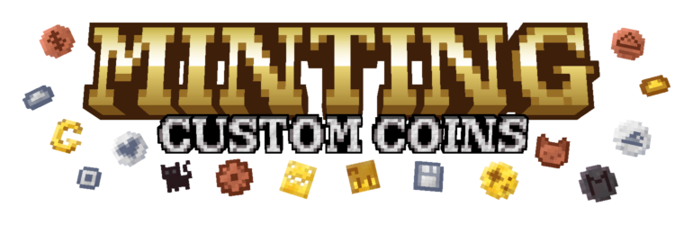
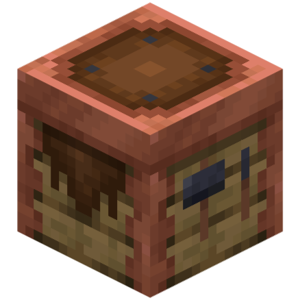
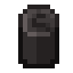
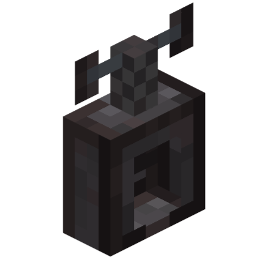
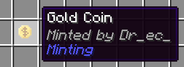
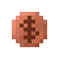
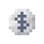
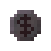

    

Minting - Custom Coins is a Minecraft currency mod that allows players to create coins with **completely custom designs**! The mod also includes anti-forgery
mechanisms to secure player created currencies for your SMP!

## Designing

A coin design can be created using the engraving table, which can be written to a striking die using a netherite ingot. The engraving table presents the player
with a 10x10 grid to draw their coin. Pixels can be subtracted with left click, and added with right click.

    
    

## Minting

Coins can then be created by combining a striking die with a nugget in a coining press. The resulting coin will have the design of the striking die, and will be
unique to the player who created it. This means that forgeries won't stack with the original, making automatic vending machines possible!

    
    

By default, there are four coin material types representing the four metals in vanilla Minecraft. Each can be minted using their corresponding nugget.

<table>
    <tr><th>Copper</th><th>Iron</th><th>Gold</th><th>Netherite</th></tr>
    <tr>
        <td></td>
        <td></td>
        <td></td>
        <td></td>
    </tr>
</table>

## Customisation

Much like the coins themselves, this mod can be easily extended using [data packs](https://minecraft.wiki/w/Data_pack).
See [the wiki for more information](https://github.com/brooke-ec/minting/wiki/Data-Pack-Customisation).